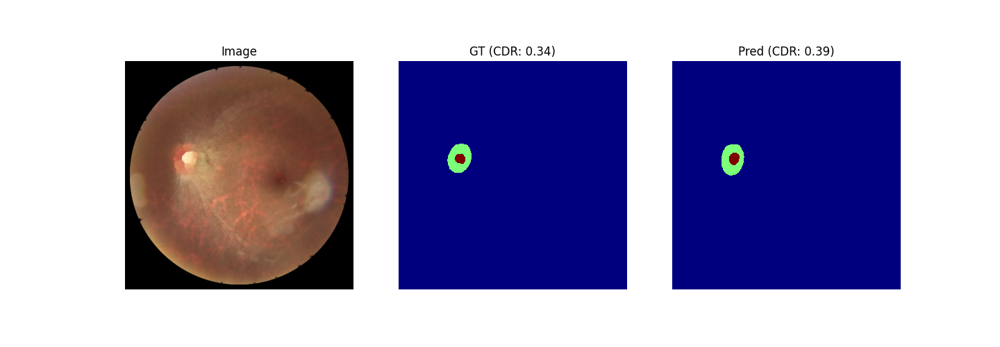
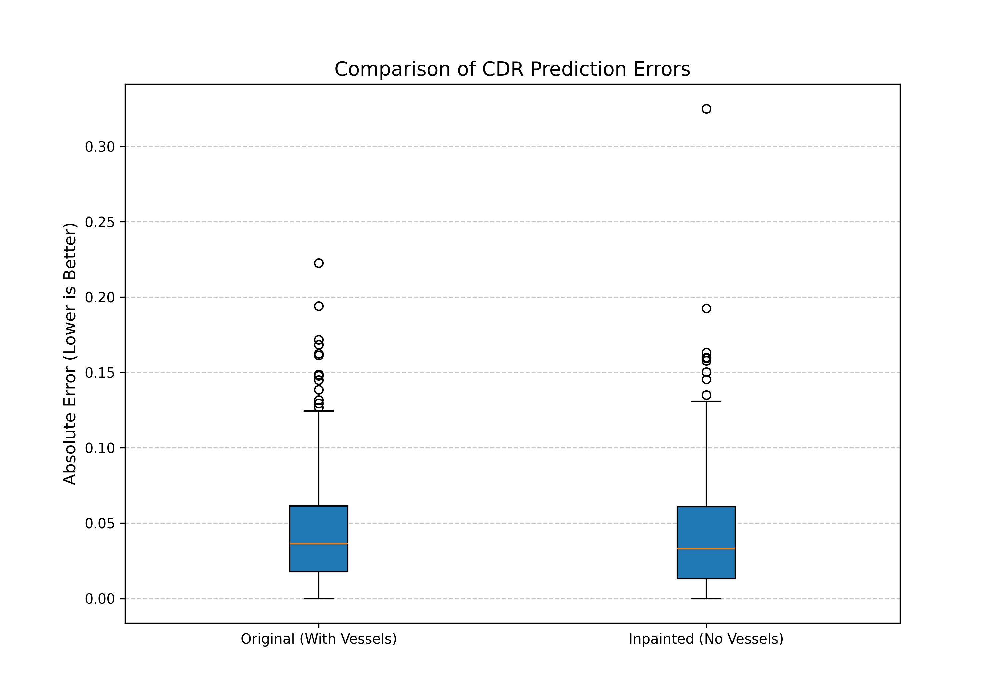

# Glaucoma Screening with Generative Vessel Inpainting

**Final-year project · BSc Computer Science (First Class), Lancaster University · PyTorch, Stable Diffusion, OpenCV**

An end-to-end deep learning pipeline for glaucoma screening from retinal fundus images. Blood vessels crossing the optic disc make the cup and disc boundaries hard to segment, so the pipeline first removes them with generative inpainting, then segments the optic disc and cup to compute the Cup-to-Disc Ratio (CDR), a key clinical indicator for glaucoma.

## Highlights

- **Vessel removal:** a U-Net segments blood vessels; Stable Diffusion inpaints them out, alpha-blended back into the original 512×512 image.
- **Quality control:** an SSIM check routes any low-fidelity diffusion output (SSIM < 0.90) to a classical Navier–Stokes fallback, so hallucinated anatomy never reaches the segmenter.
- **Result:** cup-to-disc ratio measurement error dropped by about 30% compared with using raw diffusion outputs.

<p align="center">
  
</p>
<p align="center">
  
</p>

> Model checkpoints and datasets are not included in this repository (size and dataset licensing). See **Datasets** below for the public sources.

---

## Project Structure

```
glaucoma-cdr-pipeline/
├── requirements.txt                    # Python dependencies
│
├── 01_Data_Preparation/
│   └── 01_split_and_resize_dataset.py             # Split dataset into train / val / test
│
├── 02_Vessel_Segmentation/
│   ├── bloodVesselsSegmentation.py     # Shared PyTorch Lightning module (Phase 1 U-Net)
│   ├── 01_generate_vessel_masks.py     # Generate binary vessel masks for training
│   └── 02_train_vessel_unet.py         # Train U-Net for blood vessel segmentation
│
├── 03_Generative_Inpainting/
│   ├── 01_classical_inpaint_baseline.py      # Classical inpainting baseline
│   ├── 02_stable_diffusion_nofallback.py   # Stable Diffusion inpainting (no fallback)
│   └── 03_stable_diffusion_withfallback.py # Stable Diffusion + SSIM fallback router
│
├── 04_Optic_Disc_Segmentation/
│   └── 01_train_glaucoma_unet.py       # Train multiclass U-Net (background / disc / cup)
│
├── 05_Evaluation_and_Results/
│   ├── 01_evaluate_single_image.py     # Per-image CDR comparison (baseline vs. pipeline)
│   └── 02_generate_boxplot.py          # Generate comparison box plots
│
├── 06_Full_Pipeline/
│   └── 01_full_pipeline.py             # End-to-end inference: vessel removal → CDR
│
├── checkpoints/                        # (not included: trained .ckpt files)
│   ├── 01_vessel_segmentation.ckpt
│   ├── 02_optic_disc_baseline_unet.ckpt
│   ├── 03_optic_disc_classical_inpaint_unet.ckpt
│   ├── 04_optic_disc_genai_nofallback_unet.ckpt
│   └── 05_optic_disc_genai_unet.ckpt
│
└── data/                               # (not included: download datasets below)
    ├── Task1_Blood_Vessels/
    │   └── 01_training_data/           # Amalgamated vessel-seg dataset (train / val / test + *annot masks)
    ├── Task2_Optic_Disc/
    │   ├── 01_baseline_original/       # REFUGE2 dataset (train / val / test + *annot masks)
    │   ├── 02_math_inpainted/          # Classical inpainting outputs
    │   ├── 03_genai_no_fallback/       # Stable Diffusion outputs (no fallback)
    │   └── 04_genai_with_fallback/     # Stable Diffusion outputs (with SSIM fallback)
    └── Pipeline_Intermediate_Files/    # Generated vessel masks (used by the inpainting scripts)
```

---

## Datasets

**Phase 1 — Blood-vessel segmentation.** `data/Task1_Blood_Vessels/01_training_data/` is an amalgamated dataset combining three public retinal-fundus vessel-segmentation benchmarks:

- DRIVE — Staal et al. (2004)
- CHASE_DB1 — Fraz et al. (2012)
- FIVES — Jin et al. (2022)

Images from all three sources were resized to a common resolution and split into `train / val / test` (with corresponding binary vessel masks in `trainannot / valannot / testannot`). See Section 4.2 and Section 4.3 of the report for details. Source datasets are not redistributed here — download each from its original source.

**Phases 2–5 — Optic disc / cup segmentation.** `data/Task2_Optic_Disc/01_baseline_original/` is the REFUGE2 dataset (Orlando et al., 2020), split into the same `train / val / test + *annot` layout. The remaining `Task2_Optic_Disc/` subfolders are inpainted variants produced by the scripts in `03_Generative_Inpainting/`.

---

## Pipeline Overview

```
Raw Fundus Image
      │
      ▼
[Phase 1] Vessel U-Net  →  binary vessel mask
      │
      ▼
[Phase 2] Classical Inpainting (Navier–Stokes)  →  baseline reconstruction
      │
      ▼
[Phase 3] Generative Inpainting (Stable Diffusion)  →  photorealistic reconstruction
      │
      ▼
[Phase 4] SSIM Quality-Control Router
          (falls back to Navier–Stokes output if SSIM < 0.90)
      │
      ▼
[Phase 5] Optic Disc & Cup U-Net  →  multiclass segmentation mask
      │
      ▼
      CDR = cup height / disc height  →  glaucoma risk flag
```

---

## Setup

```bash
conda create -n glaucoma_pipeline python=3.11
conda activate glaucoma_pipeline
pip install -r requirements.txt
```

> Requires Python 3.11. Tested on Apple Silicon (MPS). Set `PYTORCH_ENABLE_MPS_FALLBACK=1` for unsupported MPS ops.

---

## Usage

### 1. Prepare Data
> **Prerequisite:** raw datasets are not included in this repository. Download the four public datasets named in the **Datasets** section above from their original sources, place each under the corresponding `data/…/00_raw_input/{images,masks}/` folder, and edit the three path variables at the top of the script to match the dataset you're preparing. The script handles the 70 / 15 / 15 split and 512×512 resize automatically.

```bash
python 01_Data_Preparation/01_split_and_resize_dataset.py
```

### 2. Train Vessel Segmentation (Phase 1)
```bash
python 02_Vessel_Segmentation/02_train_vessel_unet.py
```

### 3. Generate Vessel Masks for Inpainting
```bash
python 02_Vessel_Segmentation/01_generate_vessel_masks.py
```

### 4. Run Inpainting (Phases 2–4)
```bash
# Phase 2 — classical baseline (Navier–Stokes)
python 03_Generative_Inpainting/01_classical_inpaint_baseline.py

# Phase 3 — Stable Diffusion without fallback
python 03_Generative_Inpainting/02_stable_diffusion_nofallback.py

# Phase 4 — Stable Diffusion + SSIM quality-control router
python 03_Generative_Inpainting/03_stable_diffusion_withfallback.py
```

### 5. Train Optic Disc / Cup Segmentation (Phase 5)
```bash
python 04_Optic_Disc_Segmentation/01_train_glaucoma_unet.py
```

### 6. Evaluate Results
```bash
# Per-image CDR comparison (baseline vs. pipeline)
python 05_Evaluation_and_Results/01_evaluate_single_image.py

# Aggregate box plots across the test set
python 05_Evaluation_and_Results/02_generate_boxplot.py
```

### 7. Run Full Pipeline on a Single Image
```bash
python 06_Full_Pipeline/01_full_pipeline.py
```

---

## Acknowledgements

The U-Net segmentation training code is adapted from the [segmentation_models.pytorch CamVid example](https://colab.research.google.com/github/qubvel/segmentation_models.pytorch/blob/main/examples/cars%20segmentation%20(camvid).ipynb) by Pavel Iakubovskii.